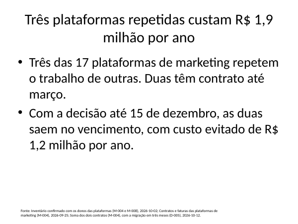
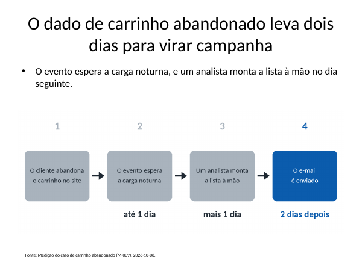
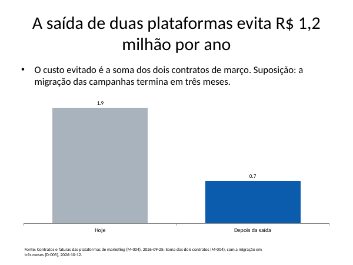

# Exemplo: um projeto do brief à entrega

Este é um projeto completo feito com o Deliverables Presentation Template, para você ver como o
trabalho fica antes de começar o seu. Ele mostra o que o consultor diz,
o que o agente registra e o arquivo que sai no fim.

Tudo aqui é inventado: a empresa, as pessoas, os contratos, os números
e também o método de avaliação do projeto. Nada serve como referência de
mercado. Em um projeto de verdade, esses registros ficam em repositório
privado.

## O projeto

A Lojas Exemplo, uma rede fictícia de varejo, contratou um diagnóstico
das plataformas de marketing. O entregável é uma leitura executiva de
dez páginas, projetada em uma reunião de diretoria de 30 minutos. A
grande ideia cabe em uma frase: a rede paga R$ 1,9 milhão por ano por
três plataformas repetidas, e a decisão sobre duas delas vence em 15 de
janeiro.

O arquivo final está em [resultado/leitura-executiva.pdf](resultado/leitura-executiva.pdf)
e em [resultado/leitura-executiva.pptx](resultado/leitura-executiva.pptx).
Ele saiu no desenho neutro do gerador, porque a consultora do exemplo
dispensou o modelo de apresentação.

| O resumo | O fluxo | O custo evitado |
| --- | --- | --- |
|  |  |  |

## O caminho, etapa por etapa

A coluna do meio traz o que a consultora disse ou fez. A consultora
nunca citou uma skill: o agente aplicou cada uma no momento certo.

| Data | O que a consultora disse ou fez | O que o agente fez | Onde está |
| --- | --- | --- | --- |
| 14 de setembro | Disse do que é o projeto e dispensou o modelo e o guia de marca | Fechou o brief, ativou o pacote do tipo de trabalho e pediu os materiais | [brief.md](entregaveis/_projeto/brief.md), [registro.tsv](entregaveis/_intake/registro.tsv), decisões D-001 a D-003 |
| 21 de setembro | Entregou o roteiro de avaliação que usa | Escreveu o método do projeto, três regras de checagem e os casos que provam cada uma | [dominio.md](entregaveis/_dominio/dominio.md), [checagens.tsv](entregaveis/_dominio/checagens.tsv), [casos.tsv](entregaveis/_dominio/casos.tsv) |
| 25 de setembro a 12 de outubro | Trouxe os contratos, as entrevistas e a medição do carrinho | Registrou cada número com fonte e data. Os relatórios de uso não chegaram, e a análise que dependia deles foi adiada | [evidencias.tsv](entregaveis/_projeto/evidencias.tsv), [adiados.tsv](entregaveis/_projeto/adiados.tsv) |
| 12 de outubro | Não disse o prazo da migração | Assumiu três meses, registrou como decisão assumida e escreveu a suposição na página | D-005 em [decisoes.md](entregaveis/_projeto/decisoes.md) |
| 19 de outubro | Pediu a leitura executiva para a diretoria | Preparou o briefing: audiência, grande ideia, pedido e resistências | [briefing.md](entregaveis/leitura-executiva/briefing.md) |
| 21 de outubro | "Aprovada. Só ponha o custo antes da nota de maturidade" | Registrou a aprovação da storyline e montou o storyboard | [storyline.md](entregaveis/leitura-executiva/storyline.md), [storyboard.md](entregaveis/leitura-executiva/storyboard.md) |
| 27 de outubro | Corrigiu dois títulos que diziam "ferramenta" | Escreveu as páginas e guardou a lição como uma checagem de termos | [conteudo.md](entregaveis/leitura-executiva/conteudo.md), L-001 em [licoes.md](entregaveis/_projeto/licoes.md) |
| 3 de novembro | | Revisou com a rubrica. A página 5 reprovou por trazer o fluxo como lista, e virou um desenho | [revisao.md](entregaveis/leitura-executiva/revisao.md) |
| 3 de novembro | Confirmou os quatro controles que o pacote de assessment traz | Registrou a evidência de cada um: os critérios, os achados com fonte, a ligação entre recomendação e achado e a conferência com os donos das plataformas | [controles.tsv](entregaveis/_projeto/controles.tsv) |
| 4 de novembro | | Preparou a versão curta, as perguntas previstas, o roteiro e a pré-leitura | [entrega.md](entregaveis/leitura-executiva/entrega.md) |
| 5 e 6 de novembro | Apresentou e contou o que a diretoria decidiu e perguntou | Registrou as decisões, respondeu à pergunta sobre a multa e guardou a lição | [fechamento.md](entregaveis/leitura-executiva/fechamento.md), D-008, D-009 e L-002 |
| 6 de novembro | Contou a reunião sem ata e deu data nova aos relatórios de uso | Registrou a reunião como relato da consultora, abriu as três tarefas com dono e prazo e guardou a data anterior do pedido | [reunioes.tsv](entregaveis/_projeto/reunioes.tsv), [acoes.tsv](entregaveis/_projeto/acoes.tsv), [prazos.tsv](entregaveis/_projeto/prazos.tsv) |
| 6 de novembro | Confirmou o nível de governança que o agente sugeriu | Leu oito semanas, uma frente e nenhum comitê, sugeriu o nível enxuto e gravou os sete materiais, quem aprova, a linha de base, o risco do aviso e a premissa da migração | D-010, [governanca.tsv](entregaveis/_projeto/governanca.tsv), [papeis.tsv](entregaveis/_projeto/papeis.tsv), [linha-de-base.tsv](entregaveis/_projeto/linha-de-base.tsv), [riscos.tsv](entregaveis/_projeto/riscos.tsv), [premissas.tsv](entregaveis/_projeto/premissas.tsv) |
| 12 de outubro a 6 de novembro | Não pediu nada | Levou o que o projeto aprendeu a seis notas, cada afirmação com o id do registro. A decisão de governança ficou só no registro, sem nota | [indice.md](entregaveis/_cerebro/indice.md), [registro.md](entregaveis/_cerebro/registro.md) |
| 20 de novembro | Disse que cobrou os relatórios de uso da diretora de marketing | Registrou a cobrança, que passa a aparecer na lista do dia | [cobrancas.tsv](entregaveis/_projeto/cobrancas.tsv) |
| 20 de novembro | Pediu o status da semana | Montou o rascunho a partir dos registros: semáforo amarelo pelo risco do aviso de não renovação, as pendências do cliente com a cobrança feita e o envio de 5 de novembro, que segue sem aceite | [status semanal](entregaveis/_projeto/emitidos/2026-11-20-status-semanal.md), [emitidos.tsv](entregaveis/_projeto/emitidos.tsv) |

## Se você tem cinco minutos

1. Abra o [PDF](resultado/leitura-executiva.pdf) e leia só os títulos.
   Eles contam a história sem o corpo das páginas.
2. Abra o [conteudo.md](entregaveis/leitura-executiva/conteudo.md). É a
   fonte de onde o arquivo sai, com a evidência de cada página.
3. Procure "Vigente (assumida)" em [decisoes.md](entregaveis/_projeto/decisoes.md).
   É assim que o agente mostra o que decidiu sem perguntar.
4. Leia a linha "Diagrama" da [revisão](entregaveis/leitura-executiva/revisao.md).
   Uma revisão de verdade reprova alguma coisa.
5. Abra o [índice do segundo cérebro](entregaveis/_cerebro/indice.md) e
   uma das notas. Cada afirmação cita o registro de onde veio.

## Abrir o exemplo rodando

O comando abaixo cria uma pasta nova com o harness instalado e o exemplo
dentro. Rode na raiz deste repositório e aponte para uma pasta fora dele.

```sh
python3 tools/abrir_exemplo.py ../exemplo-aberto
```

Na pasta nova, estes comandos mostram o harness trabalhando:

```sh
python3 entregaveis/_harness/scripts/estado.py
python3 entregaveis/_harness/scripts/validar.py --rigoroso
python3 entregaveis/_harness/scripts/gerar.py leitura-executiva --pdf --imagens
python3 entregaveis/_harness/scripts/rotina.py --hoje 2026-11-27
python3 entregaveis/_harness/scripts/rotina.py --datas
python3 entregaveis/_harness/scripts/rotina.py --lista --hoje 2026-11-27
python3 entregaveis/_harness/scripts/governanca.py
python3 entregaveis/_harness/scripts/governanca.py --desvios
python3 entregaveis/_harness/scripts/cerebro.py --buscar multa
python3 entregaveis/_harness/scripts/cerebro.py --id E-008
```

O estado lista o nível de governança, um material em falta, uma decisão
assumida e um item adiado. Eles fazem parte da história do exemplo. A
rotina compara uma data com os prazos das três tarefas da reunião: com
`--hoje`, você vê o resumo de qualquer dia, com o que está parado, o que
vence logo e o que venceu. O comando `--datas` mostra a data que mudou,
com a original e o motivo. O gerador pede o pacote `python-pptx`, e o
PDF e as imagens pedem o LibreOffice.

A lista do dia põe três itens no topo. O primeiro é o aviso de não
renovação, que só vence em janeiro e sobe porque um risco de exposição
alta o ameaça. Depois vêm os dois prazos mais próximos. Abaixo ficam o
que espera o cliente, com a cobrança de 20 de novembro, e as perguntas
da semana. O comando `governanca.py` mostra os sete materiais do nível
enxuto, e `--desvios` compara as datas de hoje com a linha de base.

A busca do segundo cérebro procura nas notas e nos registros de uma vez.
Com "multa", ela traz as quatro notas que falam do assunto e as linhas
dos registros, da evidência à lição. Com `--id`, ela mostra a linha do
registro e a nota que diz o que aquele dado significa.

Para experimentar, abra a pasta com o seu agente e peça uma mudança, por
exemplo trocar o título da página 4 por um rótulo como "Investimento". A
checagem devolve o que corrigir.

## O que o exemplo não mostra

O exemplo tem uma fase, um entregável e um idioma. Ele não traz modelo
de apresentação do cliente, documento em Word, planilha, peça interativa
nem versão em espanhol ou inglês. A pasta de atas está vazia, porque a
única reunião foi contada pela consultora. A governança fica no nível
enxuto, com os registros preenchidos e nenhum material emitido. O
método de cada uma dessas partes está em `entregaveis/_harness/metodo/`.

## Em um projeto seu

A pasta `exemplo/` serve só ao repositório do template. Em um projeto
criado a partir dele, apague a pasta ao iniciar.
