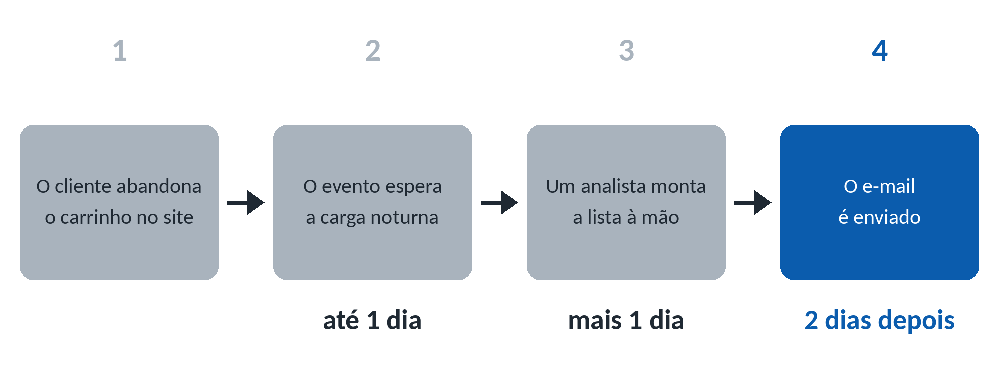

# Conteúdo

Uma página por título de nível 2, no formato `## N. Título de ação`. A
linha de comentário logo abaixo traz os campos da página. O que vem
depois de `Notas:` são as notas de quem apresenta e não conta como texto
da página.

## 1. Diagnóstico das plataformas de marketing
<!-- tipo: capa; secao: ; fonte: nao-se-aplica; recurso: -->

Leitura executiva para a diretoria da Lojas Exemplo, em 5 de novembro de 2026.

Exemplo fictício.

Notas: abra pelo motivo da reunião. Dois contratos vencem em março, e a decisão sobre eles tem data.

## 2. Três plataformas repetidas custam R$ 1,9 milhão por ano
<!-- tipo: resumo; secao: Resumo; fonte: E-002, E-003, E-007; recurso: -->

Três das 17 plataformas de marketing repetem o trabalho de outras. Duas têm contrato até março.

Com a decisão até 15 de dezembro, as duas saem no vencimento, com custo evitado de R$ 1,2 milhão por ano.

Notas: esta página é a pré-leitura. Se a reunião encurtar, vá daqui para a página 9.

## 3. Das 17 plataformas contratadas, três repetem o trabalho de outras
<!-- tipo: dados; secao: O que encontramos; fonte: E-001, E-002; recurso: -->

Cada par foi confirmado com os dois donos. Plataformas usadas por marcas diferentes ficaram fora da conta.

```grafico
tipo: barras
destaque: Repetem outra
dados:
Situação | Plataformas
Sem repetição | 14
Repetem outra | 3
```

Notas: as três são a segunda plataforma de e-mail, a segunda de automação de campanhas e a segunda de análise de dados. Responda aqui à dúvida sobre públicos diferentes: os dois donos de cada par disseram que o público é o mesmo.

## 4. As três plataformas repetidas somam R$ 1,9 milhão em contratos anuais
<!-- tipo: dados; secao: O que encontramos; fonte: E-003, E-006; recurso: -->

| Plataforma repetida | Custo anual | Contrato vence em |
| --- | --- | --- |
| E-mail B | R$ 0,7 milhão | Março de 2027 |
| Automação de campanhas B | R$ 0,5 milhão | Março de 2027 |
| Análise de dados B | R$ 0,7 milhão | Novembro de 2027 |

Notas: os valores são de contrato, sem serviços nem operação interna. As regras do projeto pedem a capacidade e uma letra no lugar do nome comercial.

## 5. O dado de carrinho abandonado leva dois dias para virar campanha
<!-- tipo: diagrama; secao: O que encontramos; fonte: E-004; recurso: caso real de carrinho abandonado, planejado na storyline -->

O evento espera a carga noturna, e um analista monta a lista à mão no dia seguinte.



Notas: conte o caso medido em 8 de outubro. Com duas plataformas de e-mail, a lista é montada duas vezes, e é aí que o tempo se perde.

## 6. A capacidade de dados e identidade ainda depende de uma área só
<!-- tipo: dados; secao: O que encontramos; fonte: E-005; recurso: -->

A nota de maturidade em dados e identidade é 2, em uma escala de 1 a 5.

O critério da nota 2: a capacidade existe em uma área, sem integração e sem dono definido. A escala está no Apêndice A.

Notas: a nota vem das entrevistas com os donos das plataformas. Sem dono para a base de clientes, a plataforma que ficar herda o mesmo atraso.

## 7. Dois contratos vencem em março, e a janela de aviso fecha em janeiro
<!-- tipo: texto; secao: O que fazer; fonte: E-006; recurso: -->

- 15 de janeiro: fim do prazo para avisar que não renova.
- Março: vencem os contratos de e-mail B e de automação de campanhas B.
- Novembro: vence o contrato de análise de dados B.

Notas: sem o aviso até 15 de janeiro, os dois contratos de março renovam por mais um ano.

## 8. A saída de duas plataformas evita R$ 1,2 milhão por ano
<!-- tipo: dados; secao: O que fazer; fonte: E-003, E-007; recurso: -->

O custo evitado é a soma dos dois contratos de março. Suposição: a migração das campanhas termina em três meses.

```grafico
tipo: colunas
destaque: Depois da saída
dados:
Cenário | Custo anual das plataformas repetidas, em R$ milhão
Hoje | 1,9
Depois da saída | 0,7
```

Notas: o que sobra é o contrato de análise de dados B, que só vence em novembro. A suposição dos três meses vem das duas últimas migrações citadas nas entrevistas.

## 9. A diretoria decide até 15 de dezembro o que sai em março
<!-- tipo: pedido; secao: O que fazer; fonte: E-006; recurso: -->

| Quem | O quê | Até |
| --- | --- | --- |
| Diretora de marketing | Decide desligar as duas plataformas de março | 15 de dezembro |
| Diretor de tecnologia | Nomeia quem conduz a migração | 15 de dezembro |
| Diretora financeira | Avisa que os contratos não renovam | 15 de janeiro |

Notas: a migração cabe entre janeiro e março, fora das datas de campanha do primeiro trimestre. A equipe que usa as plataformas B tem treinamento previsto na plataforma que fica.

## 10. Apêndice A: a escala de maturidade tem cinco notas com critério declarado
<!-- tipo: apendice; secao: Apêndice; fonte: nao-se-aplica; recurso: -->

| Nota | Nome | Critério |
| --- | --- | --- |
| 1 | Inicial | A capacidade não existe ou depende de trabalho manual e de uma pessoa |
| 2 | Em formação | Existe em uma área, sem integração e sem dono definido |
| 3 | Definida | Tem dono, processo e integração com os dados principais, com uso irregular |
| 4 | Gerida | É usada em rotina, medida por indicadores e revisada |
| 5 | Otimizada | Melhora por teste contínuo e alimenta as outras capacidades |
